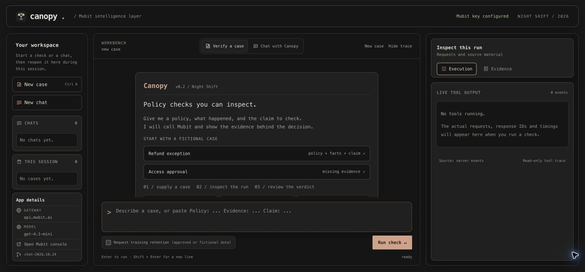
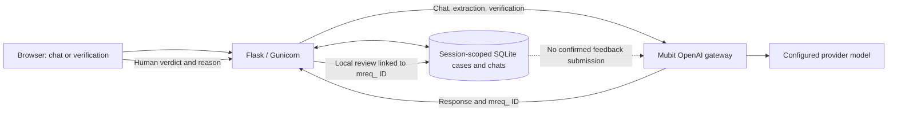

# Canopy

**Policy checks you can inspect.** Canopy is a Night Shift prototype for support and operations teams who need to check a claim against a supplied policy and case evidence. It returns **SUPPORTED**, **VIOLATES**, or **INSUFFICIENT**, with a reason and an inspectable execution trace.

[Open the deployed app](https://canopy-sbs0.onrender.com/) · [Two-minute demo guide](docs/submission/RECORDING-SCRIPT.md)

Give Canopy the policy, what happened, and the claim to test. It requests missing facts instead of filling them in. The app routes model calls through Mubit and shows the returned `mreq_` request IDs. A person can confirm or correct a verdict with a written reason; that review is currently stored in Canopy only.

The landing page opens in **Chat with Canopy** for ordinary multi-turn text conversation. Select **Verify a case** for the policy workflow. New chat starts a separate thread; earlier chats can be reopened from the sidebar. The built-in refund and access cases are fictional demo examples, not measured customer results.



## Architecture



## What runs today

1. Natural-language cases are extracted through the Mubit gateway. Missing policy or facts are requested rather than invented.
2. The recurring verification task also runs through Mubit, using the configured provider model.
3. The execution panel shows actual request IDs, model responses, token counts and timings. It is a read-only tool trace, not a shell or model chain of thought.
4. Cases and human reviews are stored in SQLite and scoped to the browser session.
5. A reviewer can supply SUPPORTED, VIOLATES or INSUFFICIENT with a reason. The review is linked to the original verification request.
6. Customer chats keep their message history in session-scoped SQLite and show real Mubit request IDs and timings. Chat is text only; it does not access unseen case history or perform a policy verdict.

**Current limitation:** human corrections are saved locally. The event team's supported correction-to-adapter integration is not connected. Canopy does not report that a model was trained, invent adapter versions, or claim measured accuracy improvement. A recorded call is not necessarily a *kept* training example.

All inference in this entrypoint goes through `https://api.mubit.ai/openai/v1`.

## Run locally

Use Python 3.11 or later. Install the existing dependencies:

```powershell
python -m pip install -r requirements.txt
$env:MUBIT_API_KEY = "your-key"
$env:MUBIT_MODEL = "gpt-4.1-mini"
python canopy.py
```

Open http://localhost:8080. An existing `.env` file is loaded; it stays gitignored. You can use `CANOPY_ENV_FILE` to point at a separate local file. Do not commit credentials.

- `PORT`: HTTP port, default 8080.
- `MUBIT_MODEL`: provider model supported by your workspace.
- `CANOPY_AGENT_DB`: SQLite path, default `canopy-agent.sqlite3` locally.
- `CANOPY_OPERATOR_TOKEN`: optional operator Basic Auth password (username `operator`). Configure it for a protected public demo; this is not multi-user identity.
- `CANOPY_PUBLIC_ORIGIN`: exact public origin for browser POST checks, for example `https://canopy-sbs0.onrender.com`.
- `MUBIT_API_KEY_FILE` and `CANOPY_OPERATOR_TOKEN_FILE`: alternative mounted-secret paths. Set a value or its file path, never both.

The browser's training-retention checkbox requests full recording for the verification or chat call. It is off by default. Extraction is not retained. Requesting recording does not guarantee that Mubit accepts a training example. Do not select retention for sensitive customer conversations without authorization.

## Event demo

1. Load the built-in fictional refund case and run it.
2. Show `mubit.extract` and `mubit.verify`, then the real `mreq_` identifiers.
3. Inspect the supplied policy, evidence and claim in the Evidence tab.
4. Save a justified human review and reopen the case to show persistence.
5. Show the current Mubit task and kept-example count. If a version has **Passed**, compare it with its provider in Try models and label that as an adapter comparison. Mubit support confirmed that Try models interactions do not contribute training examples. Canopy's saved review remains `local_only` until Mubit confirms a supported correction submission path.

A changed answer after adding evidence is context enrichment. It is not proof of model training. Use separate held-out cases and trusted labels before claiming an improvement.

The [two-minute recording guide](docs/submission/RECORDING-SCRIPT.md) uses the fictional damaged-item exception and includes an honest ending if no adapter has passed. The event submission accepts a video, not a slide deck.

## Deployment

`Procfile` starts `python canopy.py`. On Linux, this entrypoint launches Gunicorn with one worker and eight threads. The Docker image includes the UI and runtime, runs as a non-root user, and sets `CANOPY_AGENT_DB=/data/canopy-agent.sqlite3`. A Render native `Procfile` deployment does **not** inherit the Docker setting: set `CANOPY_AGENT_DB` to a mounted persistent disk path. Without a persistent disk, cases can disappear on restart or redeploy.

Health endpoints: `/livez` checks the process; `/readyz` checks key presence and local storage. Neither spends a model call. `/api/status` exposes the build identifier and reports `configured=true` when a key exists. That value does **not** prove a live Mubit request succeeded.

The previous support-policy application remains in `canopy_app/`. Set `CANOPY_APP=policy` to run it. The existing Caddy Compose deployment explicitly selects this legacy application, preserving its separate security and persistence workflow.

## Checks

```powershell
python -m unittest discover -s tests -p test_terminal.py -v
node --check canopy_ui/app.js
```

The terminal tests cover gateway request construction, provenance validation, missing evidence, recording choice, provider failure and recovery, case ownership, durable local reviews, duplicate review rejection, limits and authentication. Provider responses are mocked in unit tests. These tests do not prove the deployed service or Mubit adapter status.
They also cover multi-turn chat context, session isolation, recording choice and refusal to save replies without Mubit provenance.

Before recording, verify the deployed build, a fresh request in Mubit Requests, a review reopened in the same session, and the task's actual adapter status. The [recording guide](docs/submission/RECORDING-SCRIPT.md) lists those checks.

## Files

- `canopy.py`: application entrypoint.
- `canopy_runtime.py`: Mubit calls, run events, HTTP endpoints and storage.
- `canopy_ui/`: terminal interface, styles and browser behaviour.
- `tests/test_terminal.py`: tests for this runtime.
- `canopy_app/`: separate original support-policy implementation.
