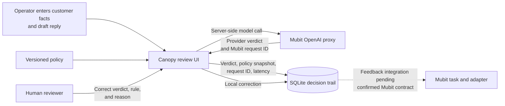

# Canopy

**Review drafted support replies against a versioned policy, then capture the human correction.** Built by Tanvir and Ritik for the Recurring tasks track at Mubit Night Shift 2026 in London.

A support reply can be **SUPPORTED**, **VIOLATES**, or **INSUFFICIENT**. The third verdict matters: when the customer facts do not justify an answer, Canopy shows that uncertainty instead of inventing one. This carries forward the original team's focus on handling insufficient evidence, now applied to one repeatable support workflow.

## How it works



The model call goes through Mubit's base URL. The API key stays server-side, and Canopy rejects a result without a Mubit request ID. Recording is off by default; the operator can request full recording for fictional or approved cases. A reviewer can correct each decision once, using the policy rules stored with that case.

**Current limit:** reviewer corrections are saved as `local_only`. The app has not verified a correction reaching Mubit or producing an adapter update. It does not display a simulated model version or claim automatic improvement. The team's earlier autonomous claim-verification and Banyan experiments remain in Git history; the current application is the support-policy workflow shown above.

## Try it locally

```bash
python3 -m venv .venv
source .venv/bin/activate
pip install --require-hashes --only-binary=:all: -r requirements.lock
export MUBIT_API_KEY="your-mubit-key"
export CANOPY_OPERATOR_TOKEN="a-random-secret-of-at-least-32-characters"
python canopy.py
```

Open <http://127.0.0.1:8080> and sign in as `operator` with `CANOPY_OPERATOR_TOKEN`. Use fictional or approved data only. The bundled refund policy is a demo policy, not a customer integration. Without a Mubit key, the interface shows live checks as unavailable.

## What to inspect

- **Live check:** verdict, latency, policy version and hash, recording choice, and Mubit request ID are stored together.
- **Human review:** one correction records the verdict, policy rule, reason, and time. It remains local until the Mubit feedback contract is confirmed and implemented.
- **Evaluation:** `canopy_app/cases.py` has 40 synthetic collection cases and 12 separate holdout cases. The [runbook](docs/OPERATIONS.md#evaluation) explains how to run them and how to interpret the results.
- **Deployment:** one Gunicorn instance, SQLite on a persistent volume, and a Caddy HTTPS template. The [production gates](PRODUCTION-READINESS.md) distinguish CI checks from live acceptance.

Application code and the sample policy live in `canopy_app/`; tests live in `tests/`. Root entry points preserve `python canopy.py`, `python manage.py`, and `python evaluate.py`. See the [runbook](docs/OPERATIONS.md) for configuration, deployment, backups, tests, and evidence collection.

## Team

Tanvir Farhad and Ritik Sah. Canopy began as a broader claim-verification prototype; the current application focuses its recurring task on support-policy review and keeps model-learning claims tied to observable Mubit evidence.
